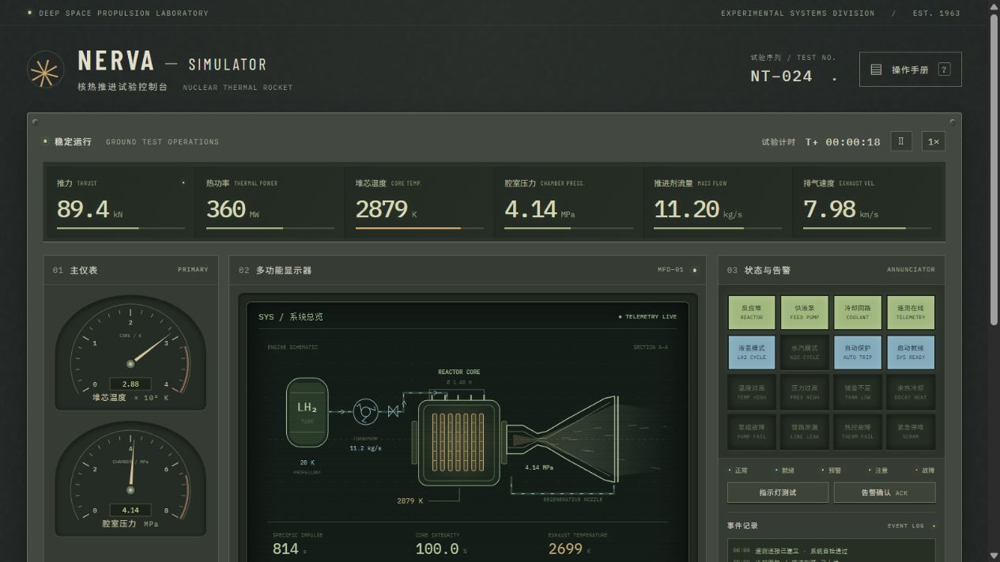
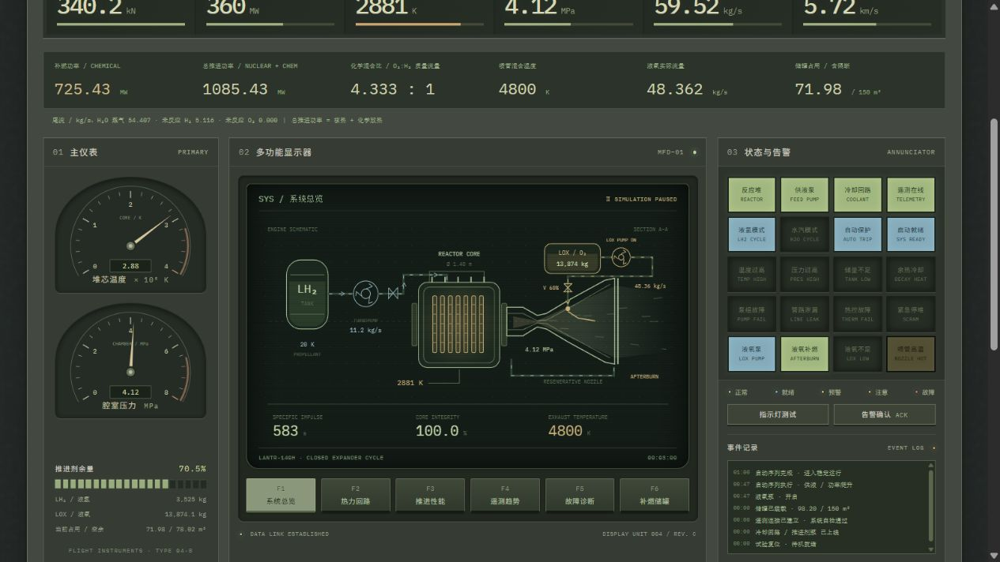
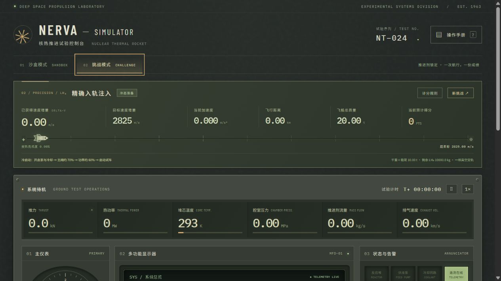

# 核热补燃模拟器 · Mini Game

**NERVA / LANTR 核热推进与液氧补燃试验控制台 · v0.11.1**

    

- **零安装**：双击 `NERVA.html` 就能玩——一个约 2.9 MB 的单文件，离线可用，没有运行时依赖，也不需要构建。
- **有物理**：Cantera 离线生成的氢 / 氧 / 水物性表，质量与能量守恒、喷管几何与突冻结近似、泵波动与残气供液。
- **有玩法**：三个计分挑战、本地排行榜、71 通道遥测与可导出的飞行记录，界面中英双语。

可直接打开的 HTML 模拟小游戏。冷战与阿波罗时代的金属仪表、绿磷 CRT、模拟表针、状态灯矩阵与机械开关，现支持纯核热推进、液氧增推 LANTR、150 m³ 储罐和三个挑战。

## English

A single-file, dependency-free browser mini-game that simulates a NERVA-style nuclear thermal rocket with LANTR oxygen afterburning. You run the reactor, pumps and valves from a retro control console, design the nozzle, load a 150 m³ propellant tank, and chase three scored challenges — unlimited Δv, a 325.00 m/s precise injection, and a 2,000.00 m/s trans-lunar injection. Physics is driven by offline-generated Cantera property tables; the whole UI switches between Chinese and English (ZH / EN). No build step, no runtime dependencies.

- **Play online**: <https://liyingcake.github.io/NTRSim-Minigame-withAfterburnner/>
- **Offline**: download `NERVA.html` and open it in any modern browser.

## 目录

| | |
| --- | --- |
| [打开](#打开) | [驾驶与窗口](#驾驶与窗口) |
| [工具提示与语言](#工具提示与语言) | [设置与快捷键](#设置与快捷键) |
| [喷管设计与延长段](#喷管设计与延长段) | [v0.11 能量与故障](#v011-能量与故障) |
| [v0.11.1 喉部面积对照](#v0111-喉部面积对照) | [150 m³ 推进剂储罐](#150-m³-推进剂储罐) |
| [液氧补燃 LANTR](#液氧补燃-lantr) | [残气与低余量供液](#残气与低余量供液) |
| [舱内监听与警音](#舱内监听与警音) | [三个挑战](#三个挑战) |
| [停机、结算与成绩](#停机结算与成绩) | [统计与飞行记录](#统计与飞行记录) |
| [性能与诊断](#性能与诊断) | [模型与参考](#模型与参考) |
| [开发验证](#开发验证) | [界面截图](#界面截图) |
| [开源协议](#开源协议) | [更新记录](CHANGELOG.md) |

## 打开

直接用浏览器打开 **NERVA.html**，无需安装依赖。源码入口是 `index.html`；开发时运行 `npm start`，访问 `http://127.0.0.1:4173`。模拟可离线运行，字体不可用时回退系统字体。修改源码后运行 `npm run standalone` 同步单文件试玩版。

在线试玩：<https://liyingcake.github.io/NTRSim-Minigame-withAfterburnner/>（单文件版 `NERVA.html` 同样可直接打开）。发布方式为 GitHub Pages：Settings → Pages → Deploy from a branch → 分支 `main`、目录 `/ (root)`；`index.html` 全部使用相对路径引用，不需要任何构建或路径改动，向 `main` 推送后会自动重新发布。

## 驾驶与窗口

- 沙盒默认 1.40 m 液氢核热引擎，60% 反应堆功率、70% 主阀；挑战从 293 K 冷态、零功率与零流量开始。
- 冷启动：打开主推进剂泵和冷却回路，设主阀约 70%、功率约 60%，点击启动。首次点火前不计时。
- 堆芯直径 0.80–2.40 m。挑战在首次点火后锁定尺寸，推进剂、货物和加注量在开局后锁定。
- 任务目标右上角「浮动」取出面板；拖动标题栏移动，方向键微调，Shift 加速。「收起」保留实时 Δv 与误差，「归位」放回顶部。窗口限制在可视范围内。
- MFD 六页：系统总览、热力回路、推进性能、遥测趋势、故障诊断、补燃储罐。F1–F6 或 1–6 切换；空格暂停，? 打开手册。
- 遥测趋势保留温度、核热功率、堆芯腔压及比冲，比冲右轴为 0–1,000 s；实际数据不因图表上限截断。
- 注入与修复泵失速、冷却故障、泄漏、主阀卡滞和传感器漂移，观察保护联锁与耐久损伤。

## 工具提示与语言

自 v0.11.1 起支持中英双语。设置旁的 **ZH / EN** 按钮切换中英文，设置内部也可切换；界面、动态遥测、MFD、挑战结算、手册和工具提示同步改变，试飞继续运行。语言自动保存。

按钮与滑条默认悬停 **1 秒**显示说明，设置中可改为 **0–10 秒**。鼠标可以移入说明，高亮关键词可悬停或点击打开次级概念卡；键盘焦点停留后按 **Tab** 进入说明，**Esc** 逐层返回。说明显示当前快捷键和不可用状态。完整范围、维护方式与验证说明见 [中英易用性说明](USABILITY-ZH-EN.md)。

## 设置与快捷键

顶部「设置」可分别调节引擎环境与警报音量，并修改快捷键、恢复默认。默认 Q / W / E / R 为主泵、冷却、自动保护、液氧泵；A 确认告警，S 启停，X 紧急停堆，T 切换速度，空格暂停，K 打开设置。1–6 可改键，F1–F6 保留切换 MFD。按键冲突会提示，输入文本、长按和弹窗中不会误触引擎。音量与按键跨版本保存在当前浏览器。

v0.8 同为 360 MW、70% 主阀时，纯核热约 827 s、30% 氧阀约 637 s，接近或略高于 v0.6；氧阀全开约 546 s，比 v0.6 低约 2.5%。这是包含流量调整的游戏参数校准，完整能量与适用范围见 [v0.8 说明](PROPULSION-V0.8.md)。

## 喷管设计与延长段

发动机配置与挑战选择页的「喷管设计」可调喉部面积、基础膨胀比、扩散半角与 0–10 m 延长段，附纵剖面和质量预览。沙盒停机且核热功率低于 5 MW 后可改，挑战首次点火后锁定。标准、紧凑、长喷管提供开局预设。

- 喉部面积参与腔压计算；出口面积固定，出口压力随实际工况求解，不再为所有流量固定 100 Pa。
- 基础段和延长段按锥台面积、等效面密度、接头和支撑计重；喷管加入引擎与飞船总质量，实际改变加速度。
- 扩散半角决定长度和轴向动量损失；延长段增加实际出口面积、热载荷、辐射面积与质量。性能和任务得分都不会随长度无限上升。
- 主腔平衡与混合站之后，喷管采用离线反应时间判据的突冻结近似，出口 H、组分携能、排速与推力共用能量预算。主控台与 F6 显示三个位置的 H；小流量用 g/s、mg/s 显示。
- 堆芯按核热、主剂吸热、冷却与热容量积分，停机余热有对应储热消耗；记录器保存几何、组分和热量通道。

模型假设、质量公式、独立对照及不同延长段的实际数据见 [v0.10 喷管说明](NOZZLE-V0.10.md)。此前的 v0.8 / v0.9 数值说明是历史版本参考。

## v0.11 能量与故障

当前几何喷管的气侧热负荷整体减半；面板显示氧入水比例、余留 O₂、净化学能、喷流动能及喷管辐射。喷管壁已有独立辐射，按壁面热收支散热，不会重复从气流扣除。

主腔压力 13 / 14 / 15 MPa 分别黄 / 橙 / 红；连续处于至少 15.5 MPa 时，每 5 个模拟秒按超压程度抽签产生部件损伤，随后累计升级为降级、故障、失效。自动保护会提前 SCRAM。F5 显示部件损伤与判定次数，飞行日志记录抽签及损伤详情。

氧反应、3,900 K 附近的温度变化、能量去向、膨胀比和半角的同设置对照及随机损伤范围见 [v0.11 核查与规则](LANTR-V0.11.md)。

## v0.11.1 喉部面积对照

当前喉部旋钮保持基础膨胀比不变，因此出口面积与喷管长度同步变化。已核对 0.25–4 倍喉部在纯氢、液氧补燃、水三种模式中的腔压、推力、比冲、质量、加速度与 Δv，并补充实际出口面积固定的对照；小喉部触发保护的行单独标记。面积、喉径、出口直径、几何膨胀比和完整表格见 [v0.11.1 喉部核查](THROAT-V0.11.1.md)。复现命令：`node scripts/audit_throat.cjs`。

## 150 m³ 推进剂储罐

所有模式使用同一体积约束，不再把旧的挑战加注量当作容量上限。货物独立于推进剂储罐。

| 物质 | 固定储存密度 | 装载价格 | 用途 |
| --- | ---: | ---: | --- |
| 液氢 LH₂ | 70.8 kg/m³ | 10 分/kg | 经过反应堆的主推进剂 |
| 液氧 LOX | 1,138 kg/m³ | 3 分/kg | 喉部之后的补燃氧化剂 |
| 水 H₂O | 1,000 kg/m³ | 2 分/kg | 单独使用的核热主推进剂 |

占用容积 = 主推进剂质量 / 密度 + 液氧质量 / 密度 + 双舱隔断。液氢与液氧同时携带时，隔断固定占 **10 m³**；液氧消耗完后隔断仍保留，不能腾出空间重新加注。水模式不装液氧。

纯液氢单舱最多 10,620 kg，纯水最多 150,000 kg。10,000 kg 液氢约占 141.24 m³，余下约 8.76 m³；这不足以支付 10 m³ 隔断，因此必须减少液氢后再带氧。示例 5,000 kg 液氢 + 20,000 kg 液氧 + 隔断共 **98.20 m³**。

挑战选择页显示分段体积条、隔断、空余、装载成本、载荷奖励和总质量，超容或参数无效时不能装载。沙盒先停机并等待核热功率低于 5 MW，再用「储罐加注」配置；支持装满单舱与 LANTR 示例。

## 液氧补燃 LANTR

主推进剂液氢先通过反应堆吸热，液氧由独立泵、调节阀供给，**在喉部之后的扩张喷管注入**。反应堆腔压与温度仍由主氢流、核热功率和冷却决定，化学放热不加回堆芯。

操作：携带液氧 → 正常启动核热引擎 → 打开液氧泵 → 调整液氧阀。热氢需达到 700 K 才允许注氧；实际氧/氢质量流量比不超过约 8。关闭液氧泵或将阀设为 0 可回到纯核热；停机、SCRAM、损毁和热氢流失会切断注氧。液氧耗尽不结束任务，液氢仍可推进；主推进剂耗尽后停堆并冷却结算，剩余氧继续算质量和返分。

补燃采用八种 H/O 气相组分的离线 Cantera 平衡表：H₂、H、O₂、O、OH、H₂O、HO₂、H₂O₂。实际氧氢化学计量质量比约 7.936。混合气温度、产物与性能共用焓预算，包含液氢 / 液氧入口焓、动量混合、解离与喷管壁面吸热；不再使用 4,800 K 硬上限。主流先膨胀到下游混合站，补燃后的末段按反应时间判据选择近似冻结位置，再按冻结组成膨胀；喷管冷却热按受限比例回到主剂总焓，降低外排损失；冻结组成结果保留作校验对照。

`输入总焓流 = 喷管壁吸热 + 实际喷流动能 + 出口焓流`

`真空推力 = 轴向动量系数 × 总流量 × 实际喷速 + 出口压力 × 实际出口面积`

`有效排气速度 = 推力 / 总流量`，`Isp = 有效排气速度 / g₀`。仪表同时标出实际喷速、压力推力和出口温度，动能功率仅用实际喷速计算。v0.10 使用实际出口面积求解出口压力，锥形半角折算轴向动量。突冻结是有限反应时间的简化近似，仍没有求解完整有限速率流场。100 Pa 固定出口与充分平衡是 v0.8 的历史参考路径。

补燃增加流量、推力和混合站温度，但更重的水汽混合物通常降低比冲。化学平衡不等于全变成水：高温下存在逆向解离，温升自然变缓。总推进功率仍显示核热功率与净化学释放功率之和，并非机械输出功率。完整推导、旧版对照、组成和能量明细见 [热化学与补燃核查报告](PROPULSION-V0.8.md)；[原始数据](benchmarks/v0.8-lantr-audit.json)可以重现。

新增喷管壁温、气侧热负荷、出口解离携能、尾流分子量和 γ。壁温按气体传热、闭式冷却与辐射积分；壁面获得的热量从同一气流焓预算中扣除。热传递使用平滑饱和，温度本身不加软上限。

系统总览 F1 在安装液氧舱时，显示独立氧罐、液氧泵、阀、供氧管线和反应堆下游喷管注入口；实时标出储量、泵开关、阀位与注氧流量。正在补燃的支路以琥珀色流动线显示，关闭时为暗色，氧耗尽后保留空罐与管路。

主控台、F6 和新增状态灯显示液氧储量、注入流量、混合比、产物分量、补燃功率、总推进功率及喷管温度。反应堆温度与喷管温度分开显示。

### 泵波动

主泵与液氧泵均具有响应惯性和可复现的慢速波动。v0.5.1 将最大幅度由 ±3.25% 降至 **±1%**，即每 10 kg/s 指令流量最大 ±0.100 kg/s。每 **1 个模拟秒** 更新一个目标值，目标之间采用平滑过渡，数值、斜率和曲率均连续，避免阶跃与高频抖动。两泵保留不同相位；波动实际参与质量消耗、温度、推力和 Δv，暂停时冻结。缺液、热氢联锁和 O/H 上限会进一步限制实际流量。

## 残气与低余量供液

主剂罐（液氢或水）和液氧罐分别以本次**初始加注质量**作为百分比基准。高于 2% 时供液系数为 1；2% 以下按 `sqrt(clamp((剩余比例 − 0.005) / 0.015, 0, 1))` 衰减，泵仍保留原有响应惯性与波动。0.5% 是不可泵送残留量，实际流量受可用质量约束，不能抽走这部分质量；主泵故障效率与残气系数相乘。这是游戏中的低液位取液近似，并未求解气液两相流。

残留推进剂继续计入飞船总质量，任务 2 / 3 也保留剩余质量返分。主剂的可用部分耗尽后自动停堆、冷却至低于 800 K 结算；液氧的可用部分耗尽后回到纯核热。主仪表显示两罐百分比、残气状态；F1 显示主剂剩余 kg 与百分比、液氧剩余 kg 与百分比；泵详情和 F2 显示实际供液效率。

## 舱内监听与警音

顶部「开启音效」激活声音，引擎环境与警报分别有音量滑块，默认 35% / 55%，设置自动保存。音效表现舱内机械传导和试车监听：仪表有低声电气底噪与操作提示音；液氢为较高频喷流和泵声，液氧补燃叠加更厚重的低频声层，水模式使用较低沉的水汽喷流。氢系具有立体声混响，音色、强弱与实际功率和流量联动。暂停、结算或页面隐藏时淡出。

高温、高压、喷管高温、泵故障、管路故障、热控故障、紧急停堆、两罐余量不足及残气供液各有独立警音节奏与音高。多告警最多四声部立体声齐鸣，紧急等级加快节奏，更多告警按优先级轮换。**ACK 停止所有警音，故障灯和实际故障保留**；新告警或已有告警升级重新鸣警。正常状态灯与余热冷却状态不反复鸣警。堆芯温度 3,050 / 3,150 / 3,250 K 分别黄 / 橙 / 红，腔压 13 / 14 / 15 MPa 分别黄 / 橙 / 红，15.5 MPa 起触发压力保护与持续超压风险。健康系统为绿色；故障按程度黄、橙、红，运行所需系统关闭时琥珀循环提示。

使用原生 Web Audio 振荡器、缓存噪声与短混响脉冲；不下载外部音频，不在逐帧 JS 中生成波形。浏览器要求声音由用户手势激活，见 [MDN 音频实践](https://developer.mozilla.org/en-US/docs/Web/API/Web_Audio_API/Best_practices)；混响使用 [ConvolverNode](https://developer.mozilla.org/en-US/docs/Web/API/ConvolverNode)。

## 三个挑战

基础船体干重 **5,000 kg**，另加引擎基体、喷管与货物。引擎基体直径 0.80–2.40 m 对应 1,000–10,000 kg，按直径平方平滑插值：`引擎质量 = 1000 + 9000 × (D² − 0.8²) / (2.4² − 0.8²)`。默认 1.40 m 引擎基体为 3,320.3125 kg，标准喷管另加约 341.06 kg，零货物总干重约 8,661.37 kg。飞行质量 = 总干重 + 剩余主剂 + 剩余液氧；沙盒与挑战共用质量与加速度计算。

| 任务 | 目标 | 额外货物 | 原始分 |
| --- | --- | --- | --- |
| 1 无限加速 | 尽可能高的 Δv | 固定 0 kg | 每 1 m/s 得 10 分 |
| 2 精确注入 | 325.00 m/s | 0–40,000 kg | 100,000 + 每 kg 货物 2 分 − 装载成本 + 余量返分 |
| 3 地月转移注入 | 2,000.00 m/s | 5,000–100,000 kg | 100,000 + 每 kg 货物 10 分 − 装载成本 + 余量返分 |

任务 2 / 3 装载成本按上表三种物质单价计算。每剩余 1 kg 主推进剂或液氧均返 1 分。先算货物奖励、成本、返分，再应用修正。任务 1 不计价格、余量或货物奖励，保留纯 Δv 计分。

- 任务 2 / 3 精度系数：`max(0, 1 − |最终Δv − 目标| × 0.01)`；每 1 m/s 误差扣 1%，绝对误差达到 100 m/s 归零。任务 1 精度系数固定 1。
- 时间系数：`max(0, 1 − 任务秒数 / 10000)`，每 100 s 扣 1%，包括冷却、滑行，首次点火前与暂停时不计。
- 耐久系数：`1 − (100 − 剩余耐久百分比) × 0.005`，每损失 10% 耐久扣 5%。
- 最终分：`max(0, floor(原始分 × 精度系数 × 时间系数 × 耐久系数))`。

所有扣分按连续比例计算，分数使用逗号千分位。目标、Δv、误差等显示两位小数，内部积分与计分保留原精度。地月场景使用用户指定的 2 km/s Δv 目标；依然是一维、无引力的注入挑战，不计算完整地月轨道。

## 停机、结算与成绩

提前降功率，留出停机惯性贡献的 Δv。停机后关闭主阀可减少主剂消耗，保持独立冷却回路运行。堆芯必须 **严格低于 800 K** 才能手动结算；主推进剂耗尽或堆芯损毁后自动停堆、冷却并结算。

成绩报告保存不可变快照：型号、尺寸、核热额定功率、载荷、初始总质量、主剂和氧的初装 / 剩余 / 消耗、罐容与隔断、首次点火设定、各峰值和全部计分明细。排行榜点击「详情」重看，「按此配置再挑战」恢复主剂、氧、货物和引擎尺寸。LANTR 型号为 `LANTR-140H` 之类，纯核热仍为 `NTR-II-140H/W`。

本地排行榜可按三个模式与主推进剂筛选，保存每种模式、每种主剂各 50 条最好成绩，取前 10 名。同分优先较短用时。数据存于当前浏览器 localStorage，不可用时暂存会话。

当前版本为 **0.11.1 / v0.11.1，挑战规则版本 10**，已加入工具提示与中英界面。压力提醒仍为 13 / 14 / 15 MPa，保护与随机损伤阈值仍为 15.5 MPa；推进物理、计分和当前排行榜保持原规则，历史发行标签不移动。`package.json` 是版本唯一来源，构建生成 `version.js` 和 `NERVA.html`。Git 发布方式见 VERSIONING.md，变化见 CHANGELOG.md。

## 统计与飞行记录

「统计与飞行记录」在沙盒和挑战中均可打开。主控台与 F3 同时显示飞船总质量、总干重、加速度和累计 Δv；结算报告增加基础 / 引擎 / 货物质量、峰值推力、全程平均与有推力段平均推力、总冲量、有推力时长、累计有效比冲、峰值加速度和船体 / 引擎推重比。推重比使用标准重力作无量纲比较，并不在真空飞行中加入重力。

- 遥测按模拟时间约 **2 Hz** 记录，保留开头 **0–60 s** 与滚动的最后 **120 s**，快照额外包含精确结束时刻；两个窗口重叠时 CSV 自动去重。长航行只保留约 362 条遥测行。
- 71 个通道含推力、热功率、压力、温度、氢 / 水与液氧流量、比冲、排速、加速度、Δv、质量、余量、阀位、功率指令、泵及冷却和保护状态等。界面表格显示常用通道，CSV 保存全部通道。
- 操作日志记录开局设置、引擎配置、加注、泵开关、功率与阀门指令、点火、停机、SCRAM、ACK、故障、暂停与倍率等。指令使用飞行时间与实际时间戳；首次点火前标为准备阶段。每次试飞最多保留 10,000 条操作，达到上限时报告被移除的条数。
- 首次点火配置、结算数据和计分各项修正均冻结保存，不会被下一局或后续操纵改写。引擎漏液只减质量，不计入喷流消耗比冲。
- 挑战结算自动归档；沙盒可保存当前快照，重置或切换任务前也会保存已经启动的试飞。选择历史档案可查看两个时间窗和指令；JSON 保存全部记录与算分依据，另可下载遥测 CSV、指令 CSV。
- 大档案存于浏览器 IndexedDB，排行榜只存摘要与档案 ID。存储受限时退回会话内记录并提示下载 JSON。档案属于当前浏览器和来源；`file://` 与 localhost 的记录通常相互独立。
- 压力表 0–0.5 MPa 增加蓝到白色带，温度表 2,950–3,200 K 增加黄色带；不增加相关发现机制提示。

氢解离的现有机制、0.5 MPa 独立核查及能量比较见 [v0.9 模型核查](HYDROGEN-V0.9.md)。这些说明只位于项目文档。

## 性能与诊断

v0.5.2 将实时 SVG 颗粒换成预制纹理，缓存网格、元素与数字格式，仅更新变化的显示值。MFD 动画页最高约 60 Hz，数据页 10 Hz，暂停和离开视口时减少重绘；物理积分独立继续，最大子步仍为 0.05 模拟秒。实测 25× LANTR 的 MFD 从约 10 FPS 升到 58 FPS，详见 [性能分析与原始测量](PERFORMANCE.md)。

开发预览地址加 `?profile=1` 可打开本地 8 秒性能采样面板，区分 RAF 回调率、MFD 绘制率和物理 / DOM / 绘图开销。正常启动不启用采样，也不发送遥测。`npm run benchmark` 运行纯 CPU 基准；`node build-texture.cjs` 可重新生成静态颗粒纹理。

v0.8 在可见预览窗口、开启液氢音效时，8 秒采样的 MFD 绘制率约 59.7 FPS、JS p95 约 0.6 ms；[采样记录](benchmarks/v0.8-browser-performance.json)保留视口和画布位置。这是单机短时验证；后台窗口可能受到浏览器节流，不能用后台数字判断正常游玩帧率。

## 模型与参考

这是交互概念演示，不用于真实设备控制或工程计算。未模拟中子学、真实燃料结构、完整低温储箱传热与蒸发，水推进也是集总假设模型。储存密度固定，不随压力温度变动；隔断是容积代价，未额外添加结构质量。质量与动量计算包含实际消耗和泄漏，泄漏不产生推力。

- [NASA LANTR 原理与可变推力 / 比冲](https://ntrs.nasa.gov/citations/20020022207)
- [NASA LANTR 下游喷管注氧说明](https://ntrs.nasa.gov/api/citations/20180008495/downloads/20180008495.pdf)
- [NASA 液氢密度参考](https://ntrs.nasa.gov/api/citations/19790004067/downloads/19790004067.pdf)
- [NASA 文献中的液氢 / 液氧储存密度](https://ntrs.nasa.gov/api/citations/19950006283/downloads/19950006283.pdf)
- [NIST 水蒸气生成焓](https://webbook.nist.gov/cgi/cbook.cgi?Name=water&cTG=on)

## 开发验证

`npm test` 检查质量与能量、容积、波动边界、残气供液、联锁、载荷和计分、告警确认、历史记录及原有发动机行为。`npm run check` 检查语法，`npm run standalone` 生成单文件。`systems.js` 集中存放罐容、价格、波动、残气；`thermochemistry.js` 与生成的 `thermo-table.js` 提供浏览器和测试共用的物性与尾流计算。132 个独立热化学状态与五个完整补燃工况对照 Cantera，测试同时检查元素、质量和能量守恒。

本地服务下打开 `tests/audio-browser.html`，点击运行，可通过 OfflineAudioContext 实际渲染三种推进音色、待机、静音与 ACK 场景。声学检查记录见 [v0.8-audio-results.json](benchmarks/v0.8-audio-results.json)。

开发测试新增本地 DOM 与文案覆盖检查；首次运行 `npm test` 前执行 `npm install`。这些依赖仅用于开发验证，不影响直接打开单文件试玩。
## 界面截图

控制台本体（`screenshots/console.jpg` 摄于 v0.5，仪表外观与 v0.11.1 一致）：

| F1 系统总览 MFD | 挑战配置 |
| --- | --- |
|  |  |

## 开源协议

本项目以 [MIT 协议](LICENSE) 发布，可自由使用、修改与再分发，保留版权声明即可。

- 这是交互概念演示，**不适用于真实设备控制或工程计算**。
- 物性表由 [Cantera](https://cantera.org/) 离线生成；储存密度与 LANTR 数值参考 NASA 公开文献，见「模型与参考」。
- 界面音效全部由原生 Web Audio 程序合成；项目内唯一的位图 `assets/panel-noise.png` 由 `build-texture.cjs` 以固定种子程序化生成，不含任何第三方素材。

问题与建议欢迎开 [Issue](https://github.com/liyingcake/NTRSim-Minigame-withAfterburnner/issues)；提交改动前请先运行 `npm install`、`npm run check` 与 `npm test`。

