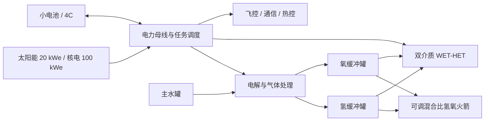

# 水基复合推进 DLC 设计提案

状态：设计基线，尚未接入现有游戏运行时。日期：2026-10-16。

建议名称：**WATERLINE / 水路航行**。定位：在现有推进控制台的基础上，让玩家经营一艘能够连续工作数年的无人飞船；用电推进完成日常修正，用预先制备的氢氧完成几分钟到几十分钟的快速机动。

## 1. 采用的设定与新增假设

用户指定的技术设定全部保留：主储存介质为水、每船超过 1 t 水；电源选 20 kW 太阳能或 100 kW 电反应堆；电池不超过 10 kWh、4C 放电；化学氢氧发动机每只 5 kg、0.5 kN，最佳工况 430 s，允许宽范围混合比；WET-HET 氧工况 2,000 s、氢工况 6,000 s；每 kg 储气系统容纳 2.5 kg 氢或 20 kg 氧。

以下是为了形成可计算型号而加入的**乐观游戏假设**，可以在后续平衡中调整，不能当作现实硬件已达到的指标：

| 新增参数 | 初始设定 | 目的 |
| --- | ---: | --- |
| 电解、干燥与储气总电耗 | 6 kWh/kg 水 | 把制气变成有时间成本的准备行为 |
| 电推母线到喷流动能效率 | 55% | 包含电源处理与电推辅机，避免比冲脱离功率 |
| 水罐干重 | 10 kg + 水容量 / 40 | 水保持便宜、易储存；大罐仍有结构成本 |
| 电池包比能量 | 200 Wh/kg | 电池只为母线和短时操作供电 |
| 20 kW 太阳能套件 | 120 kg，1 AU、正对太阳时输出 20 kWe | 包含阵列、展开和电源管理 |
| 100 kW 核电套件 | 1,200 kg，持续输出 100 kWe | 包含反应堆、转换、无人平台所需屏蔽、高温散热和电源管理 |
| 核电热电效率 | 25% | 对应约 400 kWth 与 300 kW 废热 |
| 任务母线功耗 | 0.6 / 0.8 / 1.5 / 2.0 kW | 飞控、通信、姿态与基础热控；大功率载荷须另扣 |

水罐密度沿用已有 1,000 kg/m³。气体模块按题设的质量容量比计算；这不等于给定气体密度，不能直接套用旧版液氢、液氧密度或推导现实压力。初版可把储气模块视为规定尺寸的未来技术部件，压力与具体几何作为后续参数。

真实 WET-HET 的公开研究主要是氧供阳极、氢供阴极的水电解霍尔推进；本 DLC 的可切换氢主推进及 6,000 s 是题设的未来改型。参考：[Imperial 实验室介绍](https://www.imperial.ac.uk/plasma-propulsion-lab/research/water-hall-effect-thrusters/)、[研究论文](https://spiral.imperial.ac.uk/entities/publication/d981ef58-eda7-4c63-81d3-7be6ebe43c24)。NASA 的 [PTD-1 / Hydros 介绍](https://www.nasa.gov/missions/small-satellite-missions/nasa-cubesat-to-demonstrate-water-fueled-moves-in-space/)支持在轨水电解、储气、氢氧燃烧这条架构路径，不代表本提案的推力、比冲和质量已被验证。电解电耗的量级可参考 [DOE 电解技术评估](https://www.energy.gov/sites/default/files/2024-12/hydrogen-shot-water-electrolysis-technology-assessment.pdf)中的系统指标；本提案不据此声称小型航天系统可直接复制工业系统性能。

## 2. 系统布局与必须保持的守恒



沿用现有热化学数据里的精确质量比 `O/H = 7.9360119048`，界面可以显示约 8:1。每分解 1 kg 水，得到约 0.111907 kg 氢和 0.888093 kg 氧。

- 电解只把水转移到两种气体库存，飞船总质量不变；罐体本身始终属于干重。
- 飞船质量 = 平台干重 + 任务载荷 + 剩余水 + 氢 + 氧。排气、排放、泄漏才减质量；仅有推进排气计入冲量。
- 一侧缓冲罐满时，电解受限；先消耗该气体、提供接收方或显式排放才能继续。禁止让过量副产物自动消失。
- 所有功率统一使用 kWe：`发电 + 电池放电 = 任务母线 + 电解 + 电推 + 充电`。不能分别给电解器和电推各算一遍额定电源功率。
- 长航时电池默认保留 20% SOC；低于门限先卸载电推和电解。通信突发与加热高峰另占母线。

## 3. 为什么氢 6,000 s 不等于整船 6,000 s

在统一效率假设下：

`v_e = g₀ Isp`，`F = 2 η P / v_e`，`ṁ = 2 η P / v_e²`。

所以同功率从氧切换到氢：比冲 3 倍、推力 1/3、耗气率 1/9。不能在不提高功率的情况下保留氧工况推力再把比冲乘三。

如果所有电解产物都用于电推，且各支路推进方向相同：

`整水周期总冲量比冲 = (7.936 × 2000 + 6000) / 8.936 = 2447.63 s`。

这是总冲量除以全部喷出质量的等效值；用于火箭方程时，假定双介质连续配平或以足够小的批次交替消耗。大批次先氢后氧时应按实际质量和点火顺序积分，不能把这个值当作任意操作顺序的固定瞬时比冲。

每 kg 氧的电推电耗约 97.14 kWh，每 kg 氢约 874.28 kWh。加上电解，每 kg 水的完整配平电推周期约 **190.11 kWh**。推进可用功率的平均分配为：电解 3.16%、氢电推 51.46%、氧电推 45.38%。

氢不是可以无限单独消耗的免费高比冲燃料。氢单推时会持续积累氧；氧单推时会积累氢，最终都受缓冲罐限制。若显式排放另一种气体，排放质量必须计入任务消耗和整船性能。

## 4. 四种基准型号

平台干重包含罐体、电源、推进、热控、结构、飞控和对接等任务硬件，不含表中的任务载荷。所有型号初始只装表中水量，储气由同一批水制得。

| 项目 | 水萤 M / WSP-S20-M | 水燕 L / WSP-S20-L | 水獭 T / WSP-R100-T | 水鲸 H / WSP-R100-H |
| --- | ---: | ---: | ---: | ---: |
| 定位 | 最低成本独立平台 | 轻型长期探测、维护 | 深空拖船 | 重载货运、补水节点 |
| 电源 | 20 kWe 太阳能 | 20 kWe 太阳能 | 100 kWe 核电 | 100 kWe 核电 |
| 平台干重 | 350 kg | 600 kg | 2,500 kg | 5,000 kg |
| 主水库存 / 液体体积 | 1,200 kg / 1.2 m³ | 3,000 kg / 3 m³ | 10,000 kg / 10 m³ | 30,000 kg / 30 m³ |
| 示例任务载荷 | 50 kg | 300 kg | 10,000 kg | 50,000 kg |
| 示例初始总质量 | 1,600 kg | 3,900 kg | 22,500 kg | 85,000 kg |
| 电池 | 2 kWh / 8 kW峰值 | 5 kWh / 20 kW峰值 | 8 kWh / 32 kW峰值 | 10 kWh / 40 kW峰值 |
| 仅任务母线、电池80%可用时 | 2.67 h | 5.00 h | 4.27 h | 4.00 h |
| 电解器额定功率 | 5 kW | 15 kW | 60 kW | 100 kW |
| 氢 / 氧容量 | 5 / 40 kg | 20 / 160 kg | 80 / 640 kg | 300 / 2,400 kg |
| 储气系统干重 | 4 kg | 16 kg | 64 kg | 240 kg |
| 化学发动机数量 | 1 | 2 | 6 | 20 |
| 化学总推力 | 0.5 kN | 1.0 kN | 3.0 kN | 10.0 kN |
| 示例初始化学加速度 | 0.313 m/s² | 0.256 m/s² | 0.133 m/s² | 0.118 m/s² |
| 电推配置 | 1×20 kW | 2×10 kW | 2×50 kW | 4×25 kW |

各电推单元均可选择介质，并共享电源。多单元用于冗余、分级运行、维护轮换；装机总功率不是额外发电量。重型平台与拖船使用相同 100 kW 电源，因此重型的单位质量电推加速度更低。

“最小”指这个满足至少吨级水库存的系列最小型号；1.6 t 初始质量属于小型飞船平台，不宜在文案中称作传统微纳卫星。

角色差异：

- **水萤**：最便宜、单发、单电推，适合教程和近太阳长期值守。制气器小，失误后恢复慢。
- **水燕**：电力与水萤相同，以更多水、缓冲容量、载荷和双电推换取更长寿命及更强单次机动。不是更快的巡航型。
- **水獭**：以重复利用、10 t 级拖带、对接和准时交付为主要收入来源。能够在远离太阳或阴影环境保持工作。
- **水鲸**：50 t 级载荷、30 t 水、较大储气量与多发动机组，适合低加速度长期运输和前沿补给。其成本优势是一次运得多，快速周转能力仍受 100 kW 电源约束。

## 5. 快速机动、制气时间与混合比

先把水电解到缓冲罐任一侧刚好满，再停止电解。实际配平氢氧质量分别是 5/39.68、20/158.72、80/634.88、300/2,380.80 kg，不把氧罐的少量空余当作已经装有气体。

下表使用**配平比 O/H=7.936、410 s**；以示例满载质量开始，关电推、不在燃烧中继续电解，不计点火过渡与其他耗气，得到一次缓冲罐可用的标称包络：

| 指标 | 水萤 | 水燕 | 水獭 | 水鲸 |
| --- | ---: | ---: | ---: | ---: |
| 配平气体总量 | 44.68 kg | 178.72 kg | 714.88 kg | 2,680.80 kg |
| 持续化学点火时间 | 5.99 min | 11.98 min | 15.97 min | 17.96 min |
| 一次化学 Δv | 113.88 m/s | 188.61 m/s | 129.82 m/s | 128.85 m/s |
| 停电推、从空罐恢复至配平状态 | 53.62 h | 71.49 h | 71.49 h | 164.13 h |
| 上述专用制气功率 | 5 kW | 15 kW | 60 kW | 98 kW |

“快速”是已有储气时能在几分钟内响应，不是随时把主水罐全部以化学方式烧掉。500 N、430 s 的单台发动机耗气约 **0.1186 kg/s，即 426.9 kg/h**，远高于这些电解器的连续产量。

建议混合比范围 3–10，初始平衡曲线如下。它是游戏标定，后续可用现有气相热化学与几何喷管工具校准，不声称已由 CEA 验证：

| O/H 质量比 | 3 | 4 | 6 | 7.936 | 10 |
| --- | ---: | ---: | ---: | ---: | ---: |
| 标称 Isp | 360 s | 400 s | **430 s** | 410 s | 360 s |
| 操作用途 | 强消耗氢 | 偏富氢 | 最佳比冲、余氧转电推 | 配平耗尽、释放单次缓冲能力 | 强消耗氧、保留部分氢 |

在同样从水制得的气体库存上，O/H=6 的 430 s 工况先耗尽氢，只喷出 35 / 140 / 560 / 2,100 kg，单次化学 Δv 分别为 **93.27 / 154.16 / 106.28 / 105.49 m/s**，留下 9.68 / 38.72 / 154.88 / 580.80 kg 氧。最高比冲不必然提供最高单次 Δv，因为能使用的缓冲库存不同。

也可以在任务准备时配置偏离水比例的库存，但额外生成的另一种气体仍须储存、推进消耗、转移或计价排放；不允许在出生配置里免费获得任意比例氢氧。

建议四个控制预设：

1. **巡航配平**：小功率连续制气，双介质电推按库存目标轮换；维持任务要求的快速机动余量。
2. **备战制气**：停掉或压低电推，优先补足预定化学 Δv；显示预计就绪时刻。
3. **窗口机动**：锁定任务混合比与发动机组；保持飞控供电，优先完成短时 Δv 目标。
4. **库存恢复**：消耗偏多的一种气体，逐步回到下一个合同要求的氢氧余量。

自动调度应以“可保证多少 m/s 紧急 Δv”为目标，结合当前载荷、质量和混合比估算，而不是只保证固定 10% 气罐液位。

## 6. 长航时性能与它的边界

假定不保留化学余量，水和两种气体最终全部经电推消耗、连续配平，无泄漏、无衰减、无停机；太阳能为 1 AU 连续光照。以下是**理想设计包络，不是承诺的任务寿命、实际轨道转移时长或往返能力**：

| 指标 | 水萤 | 水燕 | 水獭 | 水鲸 |
| --- | ---: | ---: | ---: | ---: |
| 扣母线后推进可用功率 | 19.4 kW | 19.2 kW | 98.5 kW | 98.0 kW |
| 氧单推瞬时推力，限已有氧库存 | 1.088 N | 1.077 N | 5.524 N | 5.496 N |
| 氢单推瞬时推力，限已有氢库存 | 0.363 N | 0.359 N | 1.841 N | 1.832 N |
| 完整配平周期平均推力 | 0.680 N | 0.673 N | 3.455 N | 3.437 N |
| 完整电推周期水消耗 | 2.45 kg/day | 2.42 kg/day | 12.44 kg/day | 12.37 kg/day |
| 以初始总质量计首日 Δv | 36.77 m/s | 14.92 m/s | 13.27 m/s | 3.49 m/s |
| 全水用于电推的理想 Δv | 33.28 km/s | 35.20 km/s | 14.11 km/s | 10.45 km/s |
| 耗完全部水的理想连续时间 | 490 day | 1,238 day | 804 day | 2,425 day |

初始质量下，水鲸完成 100 m/s 的纯电推修正约需 29 day；相同量级可由准备好的化学库存在十几分钟完成。这个差别足以支撑两类推进模式。

推进剂寿命不等于硬件寿命。重型的 6.64 年理想用水时间要求长寿命耗材、计划停机或维修；维护轮换并不能免费增加累计喷流寿命。任务应同时显示水余量、各电推剩余等效寿命和电解堆维护需求。

建议前期合同先覆盖 7–180 day，长期经营再进入 1–5 年；避免把“耗尽全部水”作为每一局的通关条件。常规任务保留 10% 水和合同规定的紧急 Δv，性能因此低于上表。

太阳能可用功率按 `20 / r_AU² × 指向效率 × 可见系数 × 健康度` 计算，再扣任务负载。2 AU 正对太阳时仅 5 kW；日食时电推和电解停止，电池保障母线。100 kW 核电在远日点的价值由此自然产生，不必额外奖励一个核电倍率。

## 7. 散热与电池必须形成真实约束

100 kWe、25% 热电效率，对应约 300 kW 源端废热。发射率 0.9、600 K 时，理想有效辐射面积约 **45.36 m²**；这是发光到冷空间的有效表面积，不等于单面投影面积，也未含遮挡、温差和工程裕量。实际造型建议预留 60–70 m² 的有效高温辐射面积。

电推的未转成喷流动能部分，初版可保守全部计入平台低温回路热负荷。100 kW 级平台约有 45 kW 电推损耗，400 K、发射率 0.9 时约需 35 m² 理想有效面积，含母线和裕量建议 40–50 m²。高温源端回路和低温设备回路分别计热，不能让 400 K 电子设备使用 600 K 的散热能力。其质量分别计入电源套件和馈送/热控项；太阳阵列自身吸收的热由阵列表面处理。

这给核电型号一个可见代价：昂贵、笨重、需要展开散热器，还会在姿态、对接和故障时受到约束。100 kW 核电不是把原版数百 MW 的核热堆模型按按钮标签改小。

10 kWh、4C 的名义峰值是 40 kW，满额峰值至多 15 min，若保留 20% SOC 则约 12 min；这只能形成短时供电能力，不能支撑长期加倍电推。基础调度默认禁止电池持续为推进增功率，电解与电推负载不能挤掉飞控；可在沙盒提供短时手动供电模式，但消耗必须入账。

## 8. 成本与干重账本

价格使用虚构游戏币 **kCr**，用于比较生产、运营和周转，不代表现实报价。水沿用原项目的相对廉价设定：2 Cr/kg，即 0.002 kCr/kg；硬件计购买成本或合同分摊折旧，不把长期可复用平台每次都作为消耗品扣全价。

公共价格：20 kW 太阳能套件 80 kCr、100 kW 核电套件 700 kCr、化学发动机 2 kCr/只；氢罐按容量 2 kCr/kg-H₂、氧罐 0.1 kCr/kg-O₂；水罐 15 + 0.003×容量kg；电池 3 kCr/kWh；电解器 5 + 3×额定kW。其他结构、馈送、热控与任务硬件分项见计算输出。

| 指标 | 水萤 | 水燕 | 水獭 | 水鲸 |
| --- | ---: | ---: | ---: | ---: |
| 平台硬件购买价 | 267.9 kCr | 479.6 kCr | 2,070.2 kCr | 3,927.4 kCr |
| 基准水库存价格 | 2.4 kCr | 6.0 kCr | 20.0 kCr | 60.0 kCr |
| 相对硬件价格 | 1.00 | 1.79 | 7.73 | 14.66 |
| 仅作载荷价格比较，不含工期 | 5.36 kCr/kg | 1.60 kCr/kg | 0.207 kCr/kg | 0.0785 kCr/kg |

最后一行是硬件价格/示例载荷，只体现规模经济；低推力导致的工期、周转率、保险、维修和对接成本必须继续计算，不能当作每次运输成本。

| 干重分项 kg | 水萤 | 水燕 | 水獭 | 水鲸 |
| --- | ---: | ---: | ---: | ---: |
| 电源套件 | 120 | 120 | 1,200 | 1,200 |
| 水罐 | 40 | 85 | 260 | 760 |
| 气罐 | 4 | 16 | 64 | 240 |
| 电池 | 10 | 25 | 40 | 50 |
| 电解与气体处理 | 12 | 32 | 122 | 202 |
| 电推与功率处理 | 28 | 40 | 150 | 240 |
| 化学发动机 | 5 | 10 | 30 | 100 |
| 馈送与低温热控 | 40 | 70 | 200 | 350 |
| 结构、飞控、姿控、对接与任务硬件 | 91 | 202 | 434 | 1,858 |
| **合计** | **350** | **600** | **2,500** | **5,000** |

这些是可调的质量预算，不是已经完成结构优化的工程最小值。最小型号给出“能完整记账的轻量基线”；物理布局定型后仍需核对结构、气罐体积、姿控、功率处理及散热质量。

在题设储气技术下，增加几十 kg 气体容量的干重代价很小，因此不能只靠罐重平衡。更大气罐会增加采购成本、提前制气时间和预制气库存；在固定出发期限下未必能装满。即使事前准备充足，大罐也不会提高长期电力预算或合同周转率。

化学发动机本体便宜且很轻，多装几台应当允许。实际制约是同一批气体可支持的点火时长、配套管路和推力结构、姿态控制及合同加速度上限。不要人为给发动机增加与题设冲突的高额质量来强行限制堆叠。

## 9. 玩法：一次飞行分成准备、值守、窗口和恢复

### 推荐任务

| 合同 | 玩家必须解决的取舍 | 合适型号 |
| --- | --- | --- |
| 30日值守 | 连续修正、日食保电，并始终保有 50 m/s 紧急能力 | 水萤 |
| 72小时后的机动窗口 | 在期限前制备指定 Δv，决定让出多少巡航功率 | 水萤 / 水燕 |
| 90日科学巡航 | 载荷占用数 kW，修正与科学工作竞争电力 | 水燕 |
| 10t货物交付 | 兼顾巡航水耗、到货时间和到站化学减速库存 | 水獭 |
| 连续三单拖运 | 上一单燃烧留下的氢氧比例影响下一单就绪时间 | 水獭 |
| 50t深空补给 | 单位运输成本低，但重载加速慢、库存恢复接近一周 | 水鲸 |
| 散热器受损后保全 | 降额发电、电推与制气，完成最低修正并恢复安全余量 | 核电两型 |

早期任务可以仍是原版的一维 Δv 窗口挑战，明确标注“简化机动合同”。任何名为精确会合、轨道交付、月球捕获的任务，必须在轨道状态和引力模型完成后才按真实轨道判定；不能把无引力一维 Δv 积分包装成已实现的轨道力学。

### 手动操作与自动计划

长航时应让玩家决定资源策略，避免要求玩家持续数小时盯屏。任务卡需要显示：预计到窗时间、可保证化学 Δv、恢复满储气所需时间、按当前功率可完成的修正量、可用散热余量、母线电池剩余维持时间。

提供“巡航至下一事件”和条件指令，例如“窗口前 12 h 转备战”“化学余量不足 80 m/s 时停止消耗氢”“到 325 m/s 自动关机”。玩家可随时覆盖。暂停规划不消耗任务时间，执行期间按模拟时间记成本与磨损。

准备和长期制气必须属于合同时间，或者由港口明确收取预处理费用。不能把所有制气放在不计时准备阶段，抹掉电解器升级和提前准备的价值。

### 磨损与故障

沿用现有分级告警、ACK、诊断和维修表现，但故障强度改为按运行小时、流量累计和启停次数定义。建议氧电推侵蚀、电解堆退化、氢泄漏、气体处理污染、太阳翼指向异常、散热器展开故障成为主要故障源。

风险可显示为剩余等效寿命或维护窗口，随机抽样用固定种子与累计危险率；时间加速不应改变抽样次数与失败概率。正常低风险工况不应被频繁抽奖强迫玩家一直开化学推进。

### 计分与经济

合同通过门槛：满足到期时刻、终态 Δv 误差、交付载荷、最低水余量和最低应急 Δv。通过后比较净收入、准点率、剩余平台寿命和资源浪费；沙盒继续提供纯性能挑战。

建议经济账：`利润 = 合同报酬 − 水与港口服务 − 平台时间成本 − 累计维护 − 硬件折旧 − 超期与损失赔偿`。排放氢氧按质量损失和服务费结算，不用另设不合理的现实环境罚款。

不要沿用原版每 100 s 扣 1% 的时间系数：它会让持续数日到数年的电推任务必然零分。按合同截止时间、软超期斜率和平台占用日成本计时，也允许玩家选择慢而便宜的合同。

## 10. 与现有项目的复用边界

| 现有资源 | 复用方式 | 需要改变的地方 |
| --- | --- | --- |
| `style.css`、`assets/panel-noise.png`、CRT/MFD 控台风格 | 直接继承视觉、仪表、开关和窗口交互 | 新增水处理、电力、储气、计划页 |
| `audio.js` | 复用声音引擎、音量、ACK 与告警节奏架构 | 新增电推电气音、电解器、阀门、短时火箭声层 |
| `settings.js` | 复用保存、快捷键和对话框交互 | 新操作使用独立动作标识，避免改坏旧快捷键 |
| `thermo-table.js`、`thermochemistry.js`、`nozzle.js` | 复用 H/O 气相物性、能量核查与喷管几何方法 | 新增常温气体入口、纯化学燃烧室入口和独立小喷管；禁止套用低温液体焓和现有 MW 反应堆喉后补燃路径 |
| `systems.js` | 复用水密度、质量与资源账本的设计方式 | 150 m³、10 m³ 隔断、液氢/液氧库存和旧残液规则不适用新型气罐 |
| `flight-recorder.js`、`flight-archive.js`、`flight-view.js` | 复用档案、不可变快照、CSV、IndexedDB 与查看器交互 | 记录器目前硬编码 NTR 字段和 5,000 kg 船体，需通过状态适配器泛化；给 DLC 独立格式版本和 kW/kWh 通道 |
| `reliability.js` | 复用损伤等级、诊断和联锁表现 | 电堆寿命、漏气、散热故障采用新规则，不套用原版 15.5 MPa 核热腔压事件 |
| `challenge.js`、`leaderboard.js` | 复用合同/挑战选择与成绩查看组件 | 新合同规则、独立模式标识、版本与榜单空间；旧的秒级扣分不能直接沿用 |
| `app.js` 和 `build-standalone.cjs` | 复用渲染调度、面板布局和离线打包方法 | 先抽出界面适配层，再加入独立水基入口 |

建议新增模块：`water-systems.js`（库存和电力）、`water-simulation.js`（热控/推进/寿命）、`water-mission.js`（合同与事件）；通过独立入口接入共享 UI 组件。

单位应在新引擎核心统一为 SI：W/J/N/kg/s，界面才换算 kW、kWh、kN、day。复用原版记录器时显式适配，不把原来的 MW 字段直接装 kW。

时间积分需要重做调度。原版 `NTRSimulation.tick()` 以最大 0.05 s 子步循环，不能直接给它传入几个月的加速时间。建议：化学燃烧和故障过渡使用 0.02–0.1 s 的受控子步；稳定电推/制气按 10–300 s 的资源与功率分段推进；休眠段跳到下一事件。库存边界、SOC 门限、热限、光照变化、寿命门限与合同窗口必须截断大步，边界到达后重新计算。固定流量段用火箭方程或守恒积分，不能用小时级显式欧拉让质量跨零。

长档案保留原版首尾细节窗口，另加稀疏全程曲线、每日统计与事件附近细节，避免只剩起飞 60 s / 末尾 120 s 而丢失几年过程。诊断图的比冲轴需支持 6,000 s，原版 1,000 s 上限不能直接继承。

## 11. 实施顺序与验收重点

第一阶段：水萤和水獭两种基准机型，水→氢氧库存、电力分配、双介质电推、可调化学混合比、快速机动储备、一维合同及事件快进。优先验证电力差异和“准备—机动—恢复”循环。

第二阶段：加入水燕、水鲸、长期磨损、维护、连续合同、港口补水和库存转移；调平成本、工期和载荷经济性。

第三阶段：按需要加入二维轨道、有限推力转移、对接与捕获窗口。轨道层独立于资源层，避免重写已经验证的水和电力账本。

物理实现时的必要验收：元素与总质量守恒、制气功率受限、同时耗电不超母线、4C 与 SOC 下限、不同介质下同功率推力关系、气体耗尽/罐满事件、混合比限制、快进倍率不改变结果、放空不产生推进冲量、核电热源与两类散热账本、准备时间进入合同成本、不同格式档案及旧版游戏兼容性。

## 12. 可复现计算

本提案的型号参数与价格在 `water-dlc-design.json`，属于设计参数，不由现有页面加载。`scripts/audit_water_dlc.cjs` 读取现有热化学元数据中的水质量比，计算分项干重、价格、储气恢复、化学燃烧和理想电推性能。

```powershell
node scripts/audit_water_dlc.cjs --write
```

结果写入 `benchmarks/water-dlc-design.json`。计算器检查质量分项、氢氧质量分数、缓冲容量、能量分配、电解功率与电池容量等约束；它不是已经完成的动态推进仿真，也不替代后续热化学/喷管验证。理想电推包络和从配平气罐开始的单次化学机动是两个分别计算的场景，不能在一次飞行里无成本相加。
